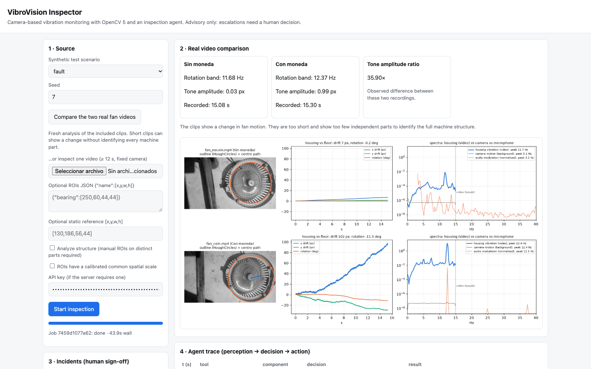
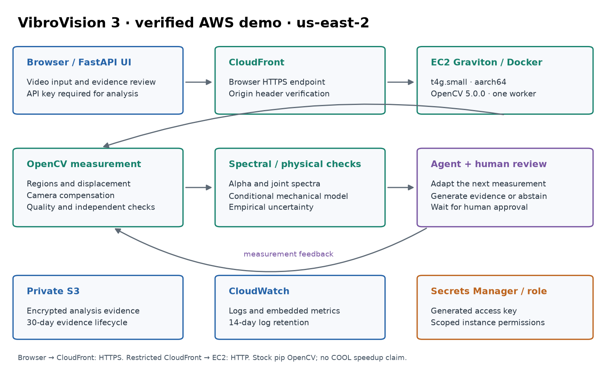

# VibroVision

**Turn machine video into motion measurements, inspectable evidence, and a clear next step.**

VibroVision uses OpenCV 5 to measure vibration from video. An inspection agent checks the measurement, adapts its next action, and requests human review. Spectral analysis and a conditional mechanical model help distinguish an observed change from a supported structural diagnosis. The expanded video explains joint motion, image-scale cancellation, natural modes and uncertainty; a [mathematical video companion](docs/VIDEO_MATHEMATICS.md) gives the exact examples and assumptions.

[Live AWS application](https://d30icy4clt3p0c.cloudfront.net/) · [Judge testing guide](docs/JUDGE_TESTING.md) · [Demonstration video — 4:33](media/vibrovision_hackathon.mp4) · [Technical report](docs/TECHNICAL_REPORT.md) · [Devpost narrative](docs/DEVPOST.md) · [Español](README_ES.md)

Live analysis requires an API key supplied separately to authorized reviewers. The page and `/healthz` are public. No credentials are included in this repository.



## What the demonstration establishes

| Evidence | Result | Scope |
|---|---|---|
| Fresh AWS fan comparison | **35.9× tone-amplitude ratio**, **43.9 s** wall time | These two recordings; not a field sensitivity or speedup benchmark |
| Synthetic video → OpenCV → mechanical operator | **2.03% relative operator error** | Controlled model-compatible benchmark |
| Randomized per-region image scales | **100 trials**; maximum relative discrepancy ≈9.1×10⁻¹⁷ | Algebraic identity under the stated model |
| Automated tests | **60 passed** | Math, tracking, invariants, video lab, API and packaging |
| Deployed runtime | **OpenCV 5.0.0**, **aarch64**, EC2 **t4g.small** | AWS Graviton in **us-east-2** |

The coin produces a large perturbation in the same fan. These short recordings observe one housing, so the system **abstains from identifying a damaged component or reconstructing the complete machine stiffness**. The alpha ranges overlap. A frequency peak is not a direct RPM measurement.

The recorded synthetic trace shows measurements changing later decisions: watch → independent cross-validation → generate evidence → request human approval. The agent is rule-based; it does not approve its own work orders or control machinery.

See the [evidence index](results/README.md) for exact executions, hashes, historical results and limits. The earlier local fan run reports approximately 36.7×; it is separate from the 35.9× AWS execution.

## Run locally

Python 3.12 or later and FFmpeg are required. Python 3.14 was used for the recorded local tests; the deployed container uses Python 3.13.

```sh
git clone https://github.com/emezac/vibrovision.git
cd vibrovision
python3 -m venv .venv
source .venv/bin/activate
python -m pip install -r requirements-dev.txt
python -m pytest -q
uvicorn service.app:app --host 127.0.0.1 --port 8000
```

Open `http://127.0.0.1:8000` and click **Compare the two real fan videos**. It analyzes the bundled clips again. Choose **fault** and **Start inspection** to run the controlled synthetic agent demonstration. Incidents remain pending until a reviewer decides.

An uploaded single video needs at least 12 seconds. Its baseline is learned inside that recording; it is not automatically a healthy-versus-damaged comparison. Structural analysis requires manually identified regions on distinct parts. Enable common spatial scale only when that assumption is calibrated or justified.

The local server has no API key by default. Set `API_KEY` in your environment before starting Uvicorn to require one. Do not commit its value.

## Reproduce the mathematical validation

```sh
python eval/run_math_validation.py --real
python docs/make_report.py
```

This regenerates `results/math_validation_v3.json` and its figure using the code and bundled fan clips. It checks scale invariance, modal sensitivities, finite stiffness loss, synthetic-video recovery and idealized alpha intervals. It does not reproduce every historical v2 experiment or certify industrial performance.

The [technical report](docs/TECHNICAL_REPORT.md) explains the mechanism in English. The [full mathematical appendix](docs/MATHEMATICS.md) provides derivations, assumptions and limits in Spanish. Bootstrap uncertainty is empirical and conditional on the model, without certified coverage.

## Google Colab and Google Drive

[Open the notebook in Colab](https://colab.research.google.com/github/emezac/vibrovision/blob/main/notebooks/vibrometria_visual_alpha_v2.ipynb).

The filename is retained for compatibility; its analysis code is v3. The notebook contains code and mathematical documentation, without embedded MP4 files.

1. Place inputs in **My Drive / Colab Notebooks / Vibrovision**, or change the Drive folder in the configuration cell.
2. Set input filenames in that cell. The owner's fan recordings are `uno.mp4` and `dos.mp4`. Reviewers can copy `data/real/fan_nocoin.mp4` and `fan_coin.mp4` to their own Drive and set those names instead.
3. For the fan-only example, set `PROBAR_MIT=False` and keep `PROBAR_VENTILADOR=True`. The optional MIT example requires the separately supplied videos.
4. Run all cells and authorize mounting your own Drive. Each execution exports new evidence and source hashes, without embedding source videos.

The supplied `tres.mp4` and `cuatro.mp4` were identical copies of a 141-second MIT/LISS showcase. The notebook analyzes one original bridge segment at 100–110 seconds, excluding amplified panels and scene cuts. It does not treat duplicates as healthy/damaged conditions. See [MIT source details](docs/MIT_VIDEOS.md).

## AWS architecture



The deployment runs a Docker container on **t4g.small**, with a 512 MiB frame-buffer limit and one analysis worker. CloudFront provides browser HTTPS. Origin ingress is restricted to CloudFront addresses and an origin-verification header. The API separately checks the user's key. Secrets Manager holds the key, private S3 stores encrypted evidence, and CloudWatch receives logs and embedded metrics.

The browser-to-CloudFront connection uses HTTPS; the restricted CloudFront-to-EC2 connection uses HTTP. This is a demonstration architecture. Confidential production workloads need encryption on that origin connection and appropriate user isolation.

```sh
aws login --profile vibrovision --region us-east-2
python3 infra/deploy_aws.py plan --profile vibrovision --region us-east-2
# Review both CloudFormation change sets before provisioning.
python3 infra/deploy_aws.py execute --profile vibrovision --region us-east-2
python3 infra/deploy_aws.py verify --profile vibrovision --region us-east-2
```

These commands create your own initial deployment; they do not attach to the existing demo. The controller does not implicitly update or replace an existing stack. Its private state is stored in `.aws-deploy/`, excluded from Git. See the [deployment guide](DEPLOYMENT_AWS.md) for validation, authentication, resource lifecycle, operational limits and costs.

The app uses stock pip OpenCV. **COOL integration and acceleration are not claimed.** Graviton availability and OpenCV build flags alone do not demonstrate a performance improvement.

## Repository map

| Location | Purpose |
|---|---|
| `vibrovision/` | Tracking, spectra, agent, mechanics and uncertainty |
| `service/` | FastAPI application and inspection interface |
| `notebooks/` | Lightweight Drive-based notebook and builder |
| `infra/` | Docker, CloudFormation, security rules and controller |
| `tests/`, `eval/`, `bench/` | Tests and reproducible experiments |
| `results/` | Labeled current and historical evidence |
| `docs/` | Narrative, English report, mathematics and diagrams |
| `data/real/` | The two supplied fan demonstration clips |
| `media/` | Combined demo, English captions and storyboard |

## Responsible operation and remaining work

Record machinery with permission and avoid capturing people. Uploaded raw videos are deleted after processing; evidence is retained separately. S3 evidence expires after 30 days. Web job state is held in memory and is not restored from S3 after a restart; persisted evidence remains in storage.

Further validation needs longer multipart recordings, independent sensor references, variable loads and camera conditions, uncertainty calibration, and separate measurements of detection, localization, abstention and false alarms. A guided region-selection workflow and persistent job history are future work.
