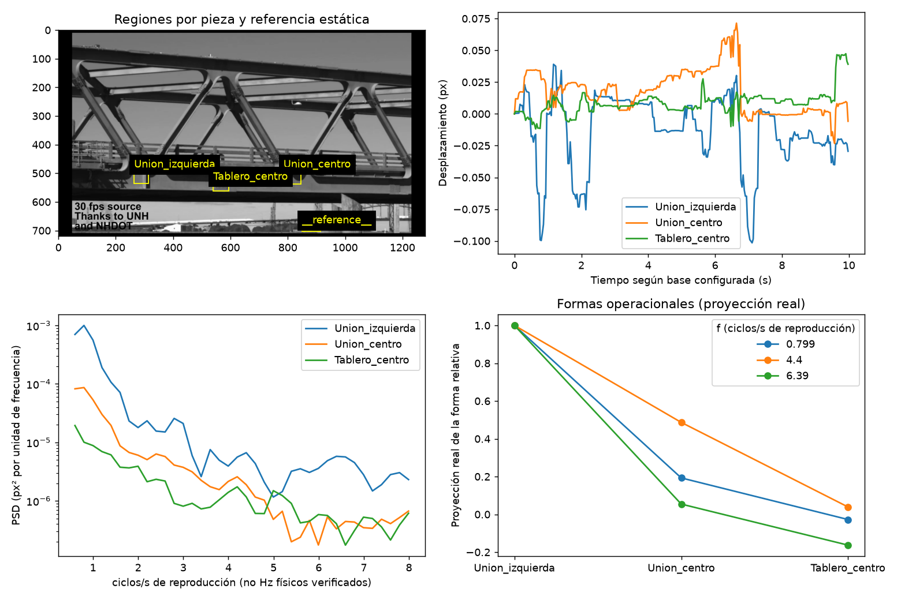

# Videos MIT LISS: configuración comprobada sobre los archivos locales

Se inspeccionaron los archivos de `/Users/admin/code/hackaton/videos`, junto con el notebook actualizado `VibroVision_Colab2.ipynb`. Las copias de Downloads con nombres parecidos no se usaron como sustituto.

## Contenido real

`tres.mp4` y `cuatro.mp4` tienen exactamente el mismo SHA-256:

`b6f2beb327fcd569ff5d6f34d1b64c0abddc04985c86ccf3efd25b2aa07a5055`

Ambos duran 141,24 s, con 4233 cuadros a 29,970 FPS y resolución 1280×720. Son dos copias de un montaje de [MIT LISS](https://web.mit.edu/liss/research-sensing.html), no la clase de dos masas. Los tiempos 654/690 s y las regiones 480×270 de aquella clase no corresponden a estos archivos.

## Ejecución en Colab

1. Conservar `CARPETA_VIDEOS="Colab Notebooks/Vibrovision"` y los archivos `uno.mp4`, `dos.mp4`, `tres.mp4`, `cuatro.mp4` en Drive.
2. Ejecutar todas las celdas y autorizar el montaje. No se descargan ni incrustan videos. Las bibliotecas compatibles ya instaladas se conservan.
3. El inventario muestra la duplicación y crea una sola medición para el contenido único. Las dos entradas quedan registradas en el JSON.
4. Se analiza el puente original de 100 a 110 s, con tres regiones de su estructura y una referencia de fondo. Este tramo evita cortes, rótulos y gráficos superpuestos.
5. IC con plantilla fija mide el movimiento pequeño; Lucas–Kanade vuelve a medir los mismos cuadros para contrastarlo. Se exportan ambas series, sus diagnósticos y sus discrepancias.

Para repetir localmente se puede definir `VIBROVISION_VIDEO_DIR=/Users/admin/code/hackaton/videos`. No hace falta una carpeta simulada ni modificar los tiempos para la prueba local.

## Qué se excluye y por qué

El montaje contiene entrevista, amplificación de color, diapositivas, tubos ralentizados y paneles amplificados. Esos segmentos no se concatenan para estimar un espectro. Tampoco se usa el puente ×400 para estimar amplitudes físicas. La frecuencia se conserva en ciclos por segundo de reproducción, porque no se verifica la cadena original de adquisición del montaje.

El puente es una estructura continua y las regiones son posiciones observadas. No son tres masas independientes ni suficientes coordenadas para reconstruir toda su rigidez. No hay una condición sana y otra dañada. La salida estructural sigue siendo abstención.

El movimiento de la escena original es muy pequeño y está afectado por compresión. La comparación entre estimadores permite ver la fragilidad de un pico: si no coinciden, se publica el desacuerdo. La coincidencia de picos dentro de dos bins es un control descriptivo, no una probabilidad de falla ni certificación modal.

El perfil está ligado al contenido mediante hash. Un video distinto queda pendiente de un perfil nuevo; nunca hereda regiones por llamarse tres.mp4. Cada ejecución conserva una carpeta nueva para no mezclar resultados antiguos.

## Evidencia de la corrección

Se ejecutaron las 14 celdas con los cuatro archivos locales reales y pasaron 55 pruebas. El seguimiento de ambas técnicas completó el fragmento, pero sus series no concuerdan en todas las regiones. Se conserva la abstención estructural. Ver `results/liss_bridge_validation.json`.

